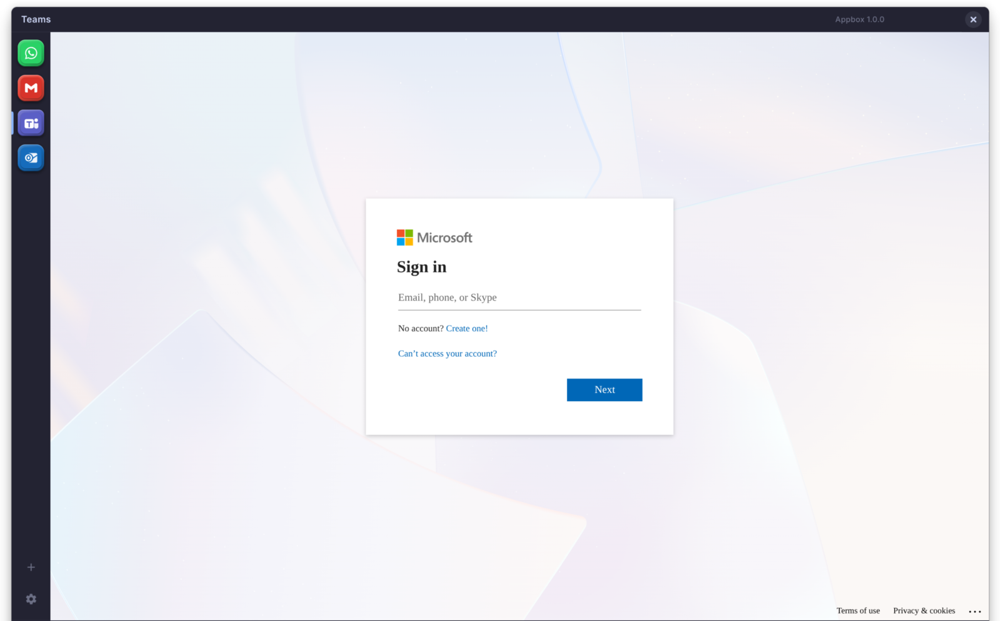
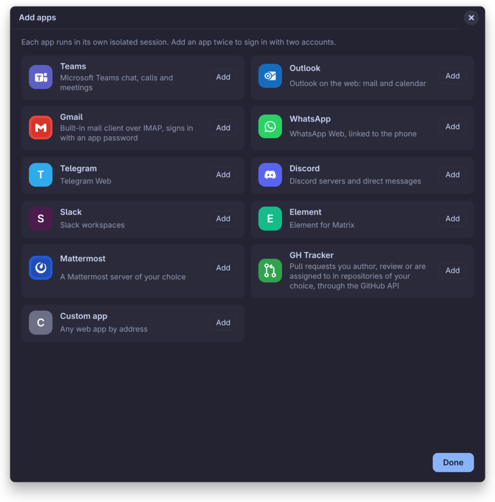
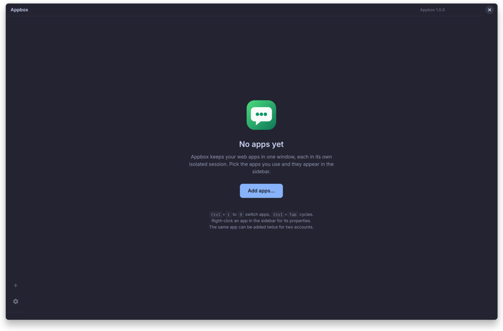

<p align="center">
  
</p>

Appbox keeps your web apps in one window, each in its own isolated
session, with a sidebar to switch between them. It ships a GitHub
tracker that lists the pull requests waiting on you. It runs on Linux on the
system Electron package, so where the distribution packages Electron
the Chromium security updates come from the distribution rather than
from a bundled runtime.

## Screenshots







## Features

- One isolated session per app: cookies, storage and logins never mix,
  and two accounts of the same service can live side by side. Two
  entries given the same `partition` in `services.json` share one
  session on purpose, and a window opened for an outside link shares
  the session of the app it came from.
- Add apps from a catalog (Teams, Outlook, Gmail, WhatsApp, Telegram,
  Discord, Slack, Element, Mattermost, GH Tracker) or by address, and
  remove them again with their login data.
- Sidebar with app icons, unread badges, drag to reorder, and a
  right-click menu with a live snapshot of the app.
- Desktop notifications bridged from each app to the system, with a
  tray icon when the desktop provides a status notifier host.
- Per-app properties: name, URL, color, notifications, sounds, forced
  dark mode, sleep when idle, startup mode, where outside links open,
  custom user agent.
- GitHub tracker: the pull requests you review, are assigned to or
  author in the repositories you name, with a "My turn" list and saved
  searches of your own.
- Dark, light or system theme for the shell and the built-in apps.
- Profile export and import, with the app sessions encrypted under a
  passphrase.
- Keyboard: Ctrl+1 to Ctrl+9 switch apps, Ctrl+Tab cycles, Ctrl+R
  reloads, Ctrl+plus, Ctrl+minus and Ctrl+0 zoom, Ctrl+Q quits.
- Status bar with the hovered link target and the page load state.

## Install

Appbox needs Linux with Electron 44 installed as a system package
(`electron44` on Arch Linux) and a Wayland or X11 session. GNOME
needs an AppIndicator extension for the tray icon.

### Arch Linux and CachyOS

The PKGBUILD in `packaging/arch` builds a package from the checkout:

```
git clone https://github.com/sylvioalves/appbox.git
cd appbox/packaging/arch
makepkg -f
sudo pacman -U appbox-*.pkg.tar.zst
```

It installs the sources under `/usr/lib/appbox`, a launcher at
`/usr/bin/appbox`, the desktop entry, the icons and the AppStream
metainfo, all named after the app id `io.github.sylvioalves.appbox`,
and depends on `electron44`.
Each release on GitHub also carries this package, built by the
release workflow. The package is not signed, so download it first and
install the local file, since `pacman -U` with a URL asks for a
signature:

```
curl -LO https://github.com/sylvioalves/appbox/releases/download/v<version>/<package file>
sudo pacman -U ./<package file>
```

### From a checkout

```
git clone https://github.com/sylvioalves/appbox.git
cd appbox
./bin/appbox
```

The launcher execs the system Electron through a symlink named
`appbox`, so the main process shows that name in `top`. It looks for
Electron at `/usr/lib/electron44/electron` and a few other paths, and
`ELECTRON_BIN` overrides the search.

### For the current user, without root

```
./install.sh
```

This copies the sources to `~/.local/lib/appbox`, links the launcher
as `~/.local/bin/appbox`, and installs the desktop entry, icons and
metainfo, so Appbox shows up in the application menu like any other
app. Run
`./install.sh --uninstall` to remove it. Configuration and sessions
are kept.

### Flatpak

The manifest in `packaging/flatpak` builds Appbox with a bundled
Electron that runs through zypak from the Electron base app, for
Flathub or a local build:

```
flatpak install flathub org.flatpak.Builder
flatpak run org.flatpak.Builder --force-clean --user --install \
  --install-deps-from=flathub build-dir \
  packaging/flatpak/io.github.sylvioalves.appbox.yml
flatpak run io.github.sylvioalves.appbox
```

Inside the sandbox the autostart entry goes through the Background
portal, so the desktop asks once whether Appbox may run in the
background, and a `launch` command of an app runs inside the sandbox.

A Debian package is planned.

## Usage

A fresh install starts with an empty sidebar and a welcome page. The
plus button at the bottom of the sidebar opens the catalog: pick an
app, or add any web app by address. Adding an app twice gives it a
second, separate session. Drag the icons to reorder them. Right-click
an app for a live snapshot and a menu, and choose Properties to
change its name, address, color, notifications, sounds, forced dark
mode, idle sleep, startup mode, link handling or user agent, or to
remove it, with or without its login data.

Keyboard shortcuts:

| Keys | Effect |
|------|--------|
| Ctrl+1 to Ctrl+9 | Switch to the n-th app |
| Ctrl+Tab, Ctrl+Shift+Tab | Next and previous app |
| Ctrl+R | Reload the active app |
| Ctrl+plus, Ctrl+minus, Ctrl+0 | Zoom in, out and reset |
| Ctrl+Shift+I | Developer tools of the active web app |
| Ctrl+Q | Quit |

Closing the window keeps Appbox running: hidden in the tray when the
desktop has a status notifier host, minimized otherwise. The tray
menu lists the apps, shows or hides the window, reloads the
configuration, toggles start at login and quits.

The gear at the bottom of the sidebar opens a small menu with "Start
at login", which writes or removes
`~/.config/autostart/io.github.sylvioalves.appbox.desktop`, or asks
the Background portal to do so when Appbox runs as a Flatpak. The
entry starts Appbox hidden in the tray. The same switch is in the
tray menu and on the command line: `appbox --autostart on|off`. The
menu also shows the running version, and `appbox --version` prints
it.

Command line flags:

| Flag | Effect |
|------|--------|
| `--show` | Start with the window visible even if the config says hidden |
| `--hidden` | Start in the tray |
| `--autostart on` / `off` | Install or remove the desktop autostart entry |
| `--quit` | Ask a running instance to quit |
| `--version` | Print the version and exit |
| `--export-profile [file] [--with-sessions]` | Write a profile archive and exit |
| `--import-profile <file> [--yes]` | Stage a profile archive for the next start and exit |

The export and import flags read the passphrase from
`APPBOX_PASSPHRASE`, which is required when the sessions are included
and when the archive is encrypted. `--yes` accepts a profile whose
apps run a `launch` command.

Appbox is single-instance: starting it again brings the running window
to the front.

## GitHub tracker

The GH Tracker app lists the pull requests tied to one GitHub user in
the repositories you name: review requested, assigned, reviewed,
commented, authored, and the ones merged in the last 30 days. It signs
in with a personal access token that can read pull requests and
metadata on those repositories (a classic token needs the `repo`
scope, or `public_repo` for public repositories only). The token is
stored through the system keyring (GNOME Keyring, or KWallet through
its Secret Service interface) and never written to the services
file, and it is not stored at all without a Secret Service keyring
unlocked at start. The GitHub GraphQL API is polled every 10
minutes with one search per list, 25 pull requests each, well inside
the API rate limit.

"My turn" holds the pull requests waiting on you: assigned without
your review yet, requested again after your review, requested on a
repository that does not use assignees, or your own with failing CI,
conflicts or requested changes, plus the issues assigned to you.
Updates on the other pull requests show as unread in "Waiting on
others". Unread items on your turn count on the sidebar badge, and
desktop notifications announce new reviews waiting and your pull
requests merged.

"New list" at the bottom of the lists saves a GitHub search of your
own, in the site's query syntax, for example
`is:pr is:open label:"platform: ESP32"` or
`is:issue is:open esp32 in:title`. A saved list is scoped to the
tracked repositories unless the query names its own, is fetched with
the other lists and never rings the badge or a notification.

The user and the repositories can be changed in the app properties,
which also forget the stored token.

## Configuration

The list of apps lives in `~/.config/appbox/services.json`. The app
writes it when you add, change or remove an app, and it can also be
edited by hand. Each entry has an `id`, `name`, `url`, a list of
allowed `hosts` (navigation elsewhere opens outside), the browser
`permissions` it may use, and the options shown in the properties
window. Set `"type": "github-tracker"` for the GitHub tracker. The catalog entries
are in `src/main/catalog.json`.

| Path | Content |
|------|---------|
| `~/.config/appbox/services.json` | Apps and global settings |
| `~/.local/state/appbox/` | Window state, tracker state, encrypted GitHub token |
| `~/.local/share/appbox/Partitions/` | One Chromium profile per app |

The `XDG_CONFIG_HOME`, `XDG_STATE_HOME` and `XDG_DATA_HOME` variables
move these as usual. Set `APPBOX_CONFIG` to use another services
file.

The gear menu exports the profile to a `tar.gz` with the app list
and state, and optionally the app sessions together with the GitHub
token. Exporting the sessions requires a passphrase of at least eight
characters, and the archive is then encrypted. Import restores an
archive on another machine, asking for the passphrase when needed.

## Security notes

- Every renderer runs with the Chromium sandbox, context isolation
  and no Node integration: the sidebar, the dialogs, the built-in
  pages, each web app and the windows opened for outside links.
- A window opened for an outside link shares the session of the app
  it came from, by design, so a login kept in that app is visible to
  the page opened in the window.
- The GitHub token is encrypted through the system keyring. Without
  a Secret Service keyring the app refuses to store it and warns once that the logins of the web apps, which
  Chromium encrypts with the same keyring key, fall back to a fixed
  built-in key.
- The services file, the window state and the tracker state are
  plain files under directories created with mode 0700.
- A profile export is encrypted with AES-256-GCM under a scrypt key
  only when a passphrase is given, which is required whenever the
  sessions are included.
- Report security issues privately, see `SECURITY.md`.

## Packaging

Besides Electron, the app calls a few programs from the user's session
and reports an error or falls back when one is missing: `tar` for
profile export and import, `xdg-user-dir` for the default download
folder (else `~/Downloads`), `gdbus` to ask the session bus whether a
status notifier host is present (no answer counts as present), and
`xdg-open` through Electron's `shell.openExternal` and `shell.openPath`
for outside links and the services file.

The launcher looks for Electron at `/usr/lib/electron44/electron`,
`/usr/lib/electron/electron`, `/usr/lib64/electron/electron` and
`/usr/local/lib/electron/electron`, in that order, and `ELECTRON_BIN`
overrides the search. The PKGBUILD depends on `electron44`. The main
process uses Node's compile cache, which needs Node 22.1 or later, as
in Electron 44. Both the launcher and the PKGBUILD unset
`ELECTRON_RUN_AS_NODE`, `NODE_OPTIONS` and `NODE_EXTRA_CA_CERTS` before
starting Electron, and any other launcher must do the same.

The app id `io.github.sylvioalves.appbox` is fixed in the code: the
desktop file, the icons and the metainfo are named after it, it is set
as the desktop name and the window class, and the autostart entry
written to `~/.config/autostart` uses it as the icon name and the
launcher path from `APPBOX_LAUNCHER`. A package that renames the
desktop file has to change those too.

A Flatpak needs, beyond the Electron base app:

- the Wayland and fallback X11 sockets, `--device=dri`, the
  PulseAudio socket and `--share=network`
- `--talk-name=org.freedesktop.secrets`, since Chromium's password
  store talks to the Secret Service directly and without it the
  GitHub token is not stored
- `--talk-name=org.freedesktop.Notifications` for desktop
  notifications
- `--talk-name=org.kde.StatusNotifierWatcher` for the tray icon
- camera and microphone device access for apps that use them, while
  screen sharing goes through the ScreenCast portal, as the PipeWire
  capturer is enabled
- `--filesystem=xdg-download`, since downloads from the apps are
  saved into the download folder

The manifest in `packaging/flatpak` sets these. Appbox detects the
sandbox through `/.flatpak-info`: the autostart entry then goes
through the Background portal with `src/main/portal.js`, a small
D-Bus client, and the answer is kept in the app state because the
host's autostart folder is not visible from inside. A `launch`
command of an app is spawned inside the sandbox.
Uninstalling never removes the autostart entry in `~/.config/autostart`.

## Development

Everything is plain JavaScript loaded by Electron, with no build
step and no dependencies beyond Electron:

| Path | Content |
|------|---------|
| `src/main/main.js` | Main process: window, tray, menus, IPC |
| `src/main/views.js` | One `WebContentsView` per app |
| `src/main/config.js`, `catalog.js`, `catalog.json` | Configuration and the app catalog |
| `src/main/profile.js`, `theme.js`, `keyring.js` | Export and import, colors, secret storage |
| `src/main/portal.js` | D-Bus client for the Background portal inside the Flatpak sandbox |
| `src/main/preload-service.js` | Preload injected into every web app |
| `src/tracker/ghtrack.js` | The GitHub tracker |
| `src/pages/<page>/` | Each built-in page: html, js, css and its `preload.js` |
| `src/pages/dialog.css` | Styles shared by the dialog pages |
| `assets/` | Icons and the banner |
| `packaging/` | Desktop entry, AppStream metainfo and the Arch PKGBUILD |

Run from source with `./bin/appbox`, with `APPBOX_CONFIG` pointing at
a scratch services file to keep your own apps aside. Before sending a
change, run the checks:

```
sh scripts/check.sh
```

This parses every file, runs the tests under `test/` and verifies the
tree. `docs/architecture.md` describes the main process, the views,
the IPC guards and the data directories, and `CONTRIBUTING.md` has
the commit rules.

## Credits

The service icons under `assets/icons` (Discord, Gmail, Mattermost,
Outlook, Teams, WhatsApp) and the GitHub mark used by the GH Tracker
icon are trademarks of their respective owners and are used only to
identify the services in the catalog and the sidebar. Appbox is not
affiliated with or endorsed by any of them.

## License

MIT, see `LICENSE`.
